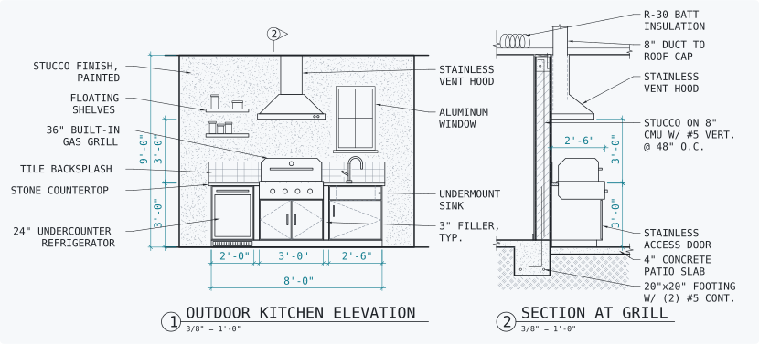
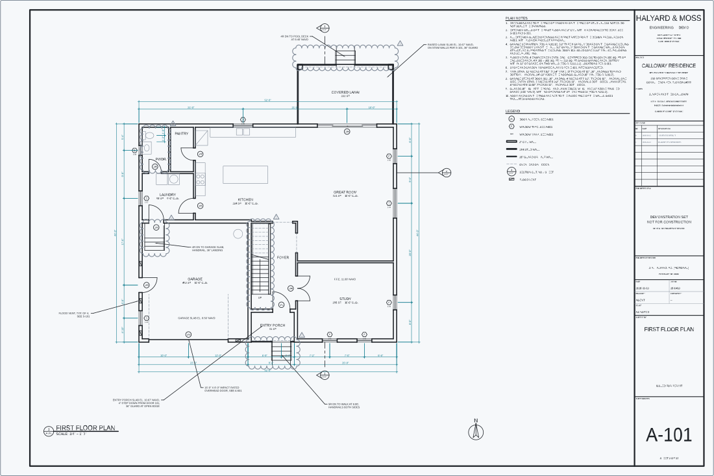

<picture>
  <source media="(prefers-color-scheme: dark)" srcset="https://raw.githubusercontent.com/Surfside-Software/tsdraft/main/docs/assets/tsdraft-logo-dark.svg">
  
</picture>

Write 2D CAD drawings in TypeScript. tsdraft writes DXF for CAD programs and SVG
for a preview, plots sheets to PDF, and reads DXF files to inspect them. Before it
writes a DXF, it refuses a drawing that breaks a rule the leading CAD app holds a
file to, such as a layer name that makes that app discard the whole file. `tsdraft dev`
redraws the drawing on every save, so you, or an agent, can see each change.

Working as an agent? Read [the guide for agents](GUIDE.md) first.

[](https://www.npmjs.com/package/tsdraft)
[](https://github.com/Surfside-Software/tsdraft/actions/workflows/ci.yml)
[](LICENSE)

<a href="https://github.com/Surfside-Software/tsdraft/tree/main/examples">
  <picture>
    <source media="(prefers-color-scheme: dark)" srcset="https://raw.githubusercontent.com/Surfside-Software/tsdraft/main/docs/assets/outdoor-kitchen-dark.svg">
    
  </picture>
</a>

The picture is what `toSVG` writes for
[`examples/outdoor-kitchen.ts`](examples/outdoor-kitchen.ts), restyled for this
page with a color for each layer. Its dimensions are tsdraft's dimensions, in
feet and inches, and its notes are leaders. The stipple and hatching are small
functions in the example that draw lines, and every size comes from a few
parameters at the top of the file.
[`examples`](examples) has the drawings and how to run them.

A smaller drawing, start to finish:

```ts
import { createDrawing, DASHED, PHANTOM, toDXF, toSVG } from "tsdraft";

const lot = { width: 120, depth: 80 }; // ft
const setbacks = { front: 20, side: 10, rear: 15 };
const house = { width: 56, depth: 32 };
const x = (lot.width - house.width) / 2;
const y = setbacks.front + 5;

// Linetype patterns are in drawing units. At a scale of 4, DASHED draws dashes of 2 ft and
// PHANTOM long dashes of 5 ft.
const d = createDrawing({ units: "ft", linetypeScale: 4 });

d.layer("C-PROP", { color: 3, linetype: PHANTOM, lineweight: 0.5 }, () => {
  d.rect([0, 0], lot.width, lot.depth);
  d.text([2, -6], `LOT ${lot.width}' x ${lot.depth}'`, { height: 3 });
});
d.layer("C-SETB", { color: 4, linetype: DASHED, lineweight: 0.25 }, () => {
  const { front, side, rear } = setbacks;
  d.rect([side, front], lot.width - side * 2, lot.depth - front - rear);
});
d.layer("A-BLDG", { color: 1, lineweight: 0.7 }, () => {
  d.rect([x, y], house.width, house.depth);
  d.text([x + 2, y + house.depth / 2], "PROPOSED RESIDENCE", { height: 3, lineweight: 0.35 });
});
d.layer("C-PAVE", { color: 8, lineweight: 0.25 }, () => {
  d.line([x + 40, y], [x + 40, -12]);
  d.line([x + 52, y], [x + 52, -12]);
});
d.layer("C-ROAD", { color: 2, lineweight: 0.35 }, () => {
  d.line([-10, -12], [lot.width + 10, -12]);
  d.text([lot.width / 2 - 10, -18], "MAIN STREET", { height: 3 });
});
d.layer("V-TREE", { color: 3, lineweight: 0.18 }, () => {
  for (let i = 0; i < 6; i++) d.circle([15 + i * 18, 72], 5);
});

const drawing = d.build();
const dxf = toDXF(drawing);
const svg = toSVG(drawing);
```

A drawing is a program, so dimensions can come from variables, drawings can
share code, and changes show up as diffs. [`examples/plan-set`](examples/plan-set)
is a 15-sheet permit set for a house, every sheet drawn from one model of it.
This is its first floor plan:

<a href="https://github.com/Surfside-Software/tsdraft/tree/main/examples/plan-set">
  <picture>
    <source media="(prefers-color-scheme: dark)" srcset="https://raw.githubusercontent.com/Surfside-Software/tsdraft/main/docs/assets/plan-set-A-101-dark.svg">
    
  </picture>
</a>

Coordinates are in drawing units with Y pointing up, as in CAD. Angles are in
degrees, counterclockwise from +X. Layer colors are numbers from the color index CAD programs share.

`toSVG` draws the drawing as it plots, an insert as what its block draws where the insert
puts it. Each layer is drawn in the color the leading CAD app plots its
index in, from 1 to 255. Index 7 is black on paper and white on a dark screen, so it is drawn
in `currentColor`. A layer that is off or frozen, or whose `plot` is false, is left out.
`toSVG(drawing, { drawNoPlot: true })` draws the layers that do not plot too, to see
construction lines. The other options are `margin`, in drawing units, and `strokeWidth`, the
width in screen pixels of a line of the default lineweight. A picture too large to write, such
as blocks nested to draw millions of entities, is refused with a `RangeError` that says where
it stopped, as [the preview of blocks](docs/blocks.md#the-preview) says.
Entities go on layer `0` unless they are drawn inside a `layer()` callback.
Linetypes and lineweights are set on a layer, and an entity draws ByLayer unless
it is given its own. `DASHED`, `HIDDEN`, `CENTER`, `PHANTOM`, `DASHDOT` and `DOT`
are the leading CAD app's own definitions; `d.linetype({ name, pattern })` defines another,
with dashes as positive lengths, gaps as negative ones and dots as 0. Its `marks` draw texts
along the line, such as a water main's letters, and shapes of a firm's shape file, such as a
fence's circles, which `parseShapes` reads and the plot takes as `shapes`. `parseLinetypes` reads
a firm's linetype file. A polyline's `linetypeGeneration` runs the pattern on past its vertices. A
lineweight is in millimetres.

A text is in the style `Standard` unless it names another. `d.textStyle({ name,
font })` defines one, with a font from `FONTS`: SHX fonts the leading CAD app installs and
TrueType fonts Windows installs. `align` and `valign` justify a text to its
point:

```ts
d.textStyle({ name: "NOTES", font: "Arial" });
d.text([60, 40], "PROPOSED RESIDENCE", { height: 3, style: "NOTES", align: "center" });
```

A symbol that repeats is a block: drawn once, and placed by inserts that scale and turn it.
A block's attributes are texts that each insert sets a value for, and that a drafter can edit
in CAD:

```ts
d.block("TREE", {}, () => {
  d.circle([0, 0], 1);
  d.attribute("TAG", [0, 1.2], { value: "T-0", height: 0.3, align: "center" });
});
d.layer("V-TREE", {}, () => {
  d.insert("TREE", [15, 72], { scale: 5, attributes: { TAG: "T-1" } });
  d.insert("TREE", [33, 72], { scale: [6, 5], rotation: 30 });
});
```

An entity on layer `0` of a block draws as the layer of each insert does.
[Blocks](docs/blocks.md) has the rest.

A drawing can reference another drawing's DWG file as an xref, and place it as it places a
block. A CAD program loads the file each time it opens the drawing:

```ts
d.xref("BASE", "../civil/base.dwg");
d.layer("X-BASE", { color: 8 }, () => d.insert("BASE", [0, 0]));
```

The path leads from the folder of the drawing's file. `toSVG` draws the referenced drawing
when it is given one, as `toSVG(drawing, { xrefs: { BASE: base } })`. [Xrefs](docs/xrefs.md)
has the rest.

A polyline's sides can be arcs and can be drawn wide, and the builder makes a few shapes of
them, each one polyline in the file:

```ts
d.polyline(hook, false, { radius: 1.5, width: 0.625 }); // a bar's hook with its bend
d.cloud(outline, { arc: 3.75 }); // a revision cloud that bulges out of its outline
d.donut([10, 10], 0.5); // a filled dot
```

`bulges` makes any side an arc, and `widths` gives each side a width at each end.
[Polylines](docs/polylines.md) has the rest.

An ellipse is drawn by its center, the end of its major axis and the ratio of its axes, and a
spline through fit points, as a top of bank or a tree line is drawn through located shots, or by
its control points:

```ts
d.ellipse([10, 5], [4, 0], 0.5);
d.spline(bank); // the cubic CAD programs fit through the points
d.controlSpline(controlPoints, { degree: 3 });
```

[Ellipses and splines](docs/curves.md) has arcs of an ellipse, tangents, closed splines, knots
and weights.

A paragraph is one text whose lines wrap at a width, which a CAD user edits as one. A line feed
starts a new paragraph, and small helpers write the codes for a numbered list, an underline,
bold, a stacked fraction and a superscript:

```ts
import { list, stack, underline } from "tsdraft";

d.paragraph(
  `GENERAL NOTES\n${list([`${underline("VERIFY")} ALL DIMENSIONS.`, `GAP 3${stack("1", "2")}"`])}`,
  {
    at: [1, 20], // the upper left corner of its box
    width: 4,
    height: 0.1,
  },
);
```

`measureParagraph` gives its lines and its box. [Paragraphs](docs/paragraphs.md) has the codes
it takes and what it refuses.

An image is a PNG or a JPEG drawn at a size in drawing units, such as an aerial under a plan or
a vicinity map on a sheet. The drawing holds the file's path and its pixels, which `rasterSize`
reads, and the plot draws the file from the bytes it is given:

```ts
import { rasterSize } from "tsdraft";

const pixels = rasterSize(readFileSync("aerial.png"))!;
d.image("aerial.png", [0, 0], {
  pixels,
  width: 400,
  clip: [
    [20, 20],
    [380, 260],
  ],
});
toPDF(drawing, { images: { "aerial.png": readFileSync("aerial.png") } });
```

[Images](docs/images.md) has clips, frames and transparency, and what `lint` refuses.

An underlay places a page of a PDF under the sheet, such as an architect's plan, by its path,
its page and the page's size, which `pdfPageSize` reads. The plot draws it from a picture of the
page you give it, since tsdraft draws no PDF. [Underlays](docs/underlays.md) has the rest.

A hatch fills the area inside its loops solid, a loop inside another a hole, draws a pattern
of the firm's pattern file there, or runs from one color to another as a gradient. A wipeout hides what is drawn before it, and a paragraph's mask
hides it behind the text:

```ts
d.hatch([
  {
    points: [
      [0, 0],
      [96, 0],
      [96, 8],
      [0, 8],
    ],
  },
  {
    points: [
      [36, 0],
      [72, 0],
      [72, 8],
      [36, 8],
    ],
  },
]);
d.paragraph("VERIFY IN FIELD", { at: [40, 20], height: 3, mask: true });
```

[Fills, wipeouts and masks](docs/fills.md) has holes and arcs, patterns, gradients, wipeouts' frames, a
dimension style's mask and the draw order.

A dimension measures between two points and writes what it measures. In the file it is a
dimension, which a CAD program measures again when its points move, and a dimension style says how
it is drawn:

```ts
d.dimensionStyle({
  name: "PLAN",
  textHeight: 0.9,
  arrowhead: "architectural-tick",
  arrowSize: 0.6,
  extensionOffset: 0.6,
  extensionBeyond: 1.2,
  textGap: 0.6,
  precision: 1,
  suffix: "'",
});
d.linearDimension([34, 30], [86, 30], [0, 22], { style: "PLAN" }); // 52.0'
```

`alignedDimension` measures along the two points, and a style with `units: "architectural"`
writes feet and inches, as `4'-1 7/16"`, with the fraction on the line or stacked. A style puts
the text above the line or in a break of it and moves a text with no room out on a leader, and
a dimension takes words below its line. [Dimensions](docs/dimensions.md) has the rest.

A layout is a sheet of paper that a CAD program shows as a tab and plots as one page. What is drawn
inside `layout` is on the sheet, in inches of paper, and a viewport shows the model on it at a
scale:

```ts
d.layer("G-ANNO-NPLT", { color: 8, plot: false });
d.layout("C-101", { paper: "ARCH D" }, (sheet) => {
  d.rect([0.5, 0.5], sheet.width - 1, sheet.height - 1);
  d.layer("G-ANNO-NPLT", {}, () =>
    sheet.viewport([1, 1], 34, 22, { center: [50, 70], ratio: 120 }),
  );
});
```

The file opens on the sheet with its page setup: `DWG To PDF.pc3`, the paper, 1:1 and
`monochrome.ctb`. `toSVG(drawing, { layout: "C-101" })` draws the sheet as it plots, and
`toPDF(drawing)` plots every sheet to one PDF, a page each, with no CAD program.
[Layouts](docs/layouts.md) has the rest, [Plotting](docs/plotting.md) the PDF, and
[Title blocks](docs/title-blocks.md) shows a title block whose fields are attributes.

Text, symbols and dashes are sized by how large they plot. `fromPaper` turns a
length on paper into drawing units for one scale, given as a plain ratio:

```ts
import { fromPaper } from "tsdraft";

const view = { ratio: 120, units: "ft" } as const; // 1" = 10'
const note = fromPaper(3 / 32, "in", view); // 0.9375 ft
d.text([0, 0], "PROPERTY LINE", { height: note });
```

A paper unit other than `"in"` or `"mm"`, and a length or a ratio of 0 or less,
are compile errors as literals and thrown errors otherwise. `fromPaper` also
throws when the result would be written as 0 or is 1e100 or more.
[`examples/site-plan.ts`](examples/site-plan.ts) is a whole sheet, and the file
to copy to start a drawing: its plan is in model space, with its annotation
sized this way, and its border, title block and notes are on a layout.

## Status

tsdraft is early, and its API still changes. Until 1.0 any release, a patch
included, can break code written for the one before. [CHANGELOG.md](CHANGELOG.md)
starts each breaking change with `Breaking:`.

It draws layers, lines, polylines with arcs and widths, rectangles, revision clouds, donuts,
circles, arcs, single-line text and paragraph text that wraps to a width, with lists, tab
stops and columns, linetypes and lineweights, an entity's own color by index or as a true color, text styles and justification, blocks with attributes and inserts
of them, references to DWG files as xrefs, linear and aligned dimensions in decimal units or
feet and inches with stacked fractions, words below the line and text on a leader, leaders, layouts with a page setup and viewports, which can freeze their own
layers or twist the view, and layers that are off, frozen, locked or not plotted. A firm's
[standard](docs/standard.md) sets its layers, pens, text and sheets. It writes DXF, not DWG.

It does not yet have overlines in paragraph text, ellipses, splines or points, tables, PDF underlays,
or the other kinds of dimension.

`readDXF` reads an ASCII DXF into a model to inspect, which is not a drawing tsdraft can edit
and write again. [Reading drawing files](docs/reading.md) has what it reads.

The rules tsdraft checks are the leading CAD app's. Other CAD programs may hold a drawing to
other rules.

## Install

```sh
npm install tsdraft
```

tsdraft is an ES module and needs Node 22 or later. The library imports nothing at run
time, from npm or from Node.

## The `tsdraft` command

The package comes with a command that runs a drawing file and shows the drawing, with no CAD
program:

```sh
npx tsdraft render plan.ts   # writes an SVG and a PNG, and prints JSON with what lint found
npx tsdraft render plan.ts --pdf   # also plots each sheet, and the set, to PDF
npx tsdraft dev plan.ts      # a live preview that redraws on every save
```

A drawing file is a TypeScript module whose default export is a drawing. The command needs
Node 22.18 or later, and the project's `package.json` must say `"type": "module"`.
[docs/command.md](docs/command.md) describes the commands and the JSON, and
[the guide for agents](GUIDE.md) describes the loop to work in.

The PNG is drawn by `@resvg/resvg-js`, the package's one dependency. npm installs it, with a
native build for the platform, unless optional packages are left out. Only the command loads
it. Installed with `--omit=optional`, the command still writes the SVG and the JSON, and the
JSON says why there is no PNG.

## DXF versions

A drawing is written for one DXF version. `createDrawing()` targets R2018, the
newest published version, in use since 2018. `createDrawing({ dxf: "R12" })`
targets R12, the oldest version still in common use, which nearly every CAD program can open. `toDXF(drawing)` writes
the drawing's version, and `toDXF(drawing, { version })` writes another one.

|                           | `"R2018"`, the default                                                  | `"R12"`                                            |
| ------------------------- | ----------------------------------------------------------------------- | -------------------------------------------------- |
| Format code               | AC1032                                                                  | AC1009                                             |
| Drawing units             | Stored in `$INSUNITS`.                                                  | Not stored. Set them in CAD with `UNITS`.          |
| Polylines                 | `LWPOLYLINE`                                                            | `POLYLINE` with `VERTEX` records                   |
| Polyline arcs and widths  | Yes                                                                     | No                                                 |
| Paragraph text            | `MTEXT`                                                                 | No                                                 |
| Text                      | UTF-8                                                                   | ASCII, with `\U+XXXX` escapes for other characters |
| Layer names               | Up to 255 characters, except those in [the rules](docs/rules.md#errors) | Up to 31 letters, digits, `$`, `-` and `_`         |
| Linetypes, lineweights    | Yes                                                                     | No: only `Continuous`, and no lineweights          |
| Layer off, frozen, locked | Yes, and not plotted                                                    | No                                                 |
| Dimensions                | Linear and aligned                                                      | No                                                 |

R12 gets no new features. Choose it only for a program that cannot read R2018.
CAD needs the stored units to scale a drawing inserted into another, and the leading
CAD app shows layer names from an R12 file in upper case.

## Checks

The leading CAD app discards a whole drawing over one bad layer name, and it
reports no line of your code when it does. tsdraft checks that app's rules at
three points, so the mistake shows up where you made it.

1. **In the editor.** Layer names, colors, sizes and fonts written as literals are
   checked by the TypeScript compiler, and the error message says what is wrong.
2. **When the code runs.** The builder throws at the call that breaks a rule.
   This covers values the compiler cannot see, such as a name read from a file.
3. **Before export.** `lint(drawing)` returns every problem in a drawing, and
   `toDXF` throws a `DrawingError` that lists them instead of writing a file
   that app would reject.

```ts
const d = createDrawing({ units: "ft", dxf: "R12" });

d.layer("A WALL");
// error TS2345: Argument of type '"A WALL"' is not assignable to parameter of
// type '"R12 layer names can only use letters, digits, $, - and _. Use DXF
// version \"R2018\" for other characters"'.

createDrawing().layer("A WALL"); // fine

lint(drawing, { version: "R12" }); // check a drawing against another version
```

## Reference

- [Rules](docs/rules.md) lists what `lint` refuses and what it warns about.
- [The Drawing format](docs/format.md) covers format 0, entity ids, `toJSON`
  and `fromJSON`, and what a diagnostic carries.
- [Layer names](docs/layer-names.md) explains how the leading CAD app compares layer and
  linetype names, and lists the pairs `AUDIT` calls duplicates and the
  characters it refuses.
- [Blocks](docs/blocks.md) covers blocks, inserts and attributes: layers in a
  block, names, handles and what the preview draws.
- [Polylines](docs/polylines.md) covers arcs by their bulge, rounded corners, revision clouds,
  widths and donuts, how a wide polyline plots, and what `lint` refuses of them.
- [Ellipses and splines](docs/curves.md) covers ellipses and their arcs, splines through fit
  points and by control points, how they plot and dash, and what `lint` refuses of them.
- [Paragraphs](docs/paragraphs.md) covers paragraph text: its width and box, the codes its
  value takes, the helpers that write them, how it is laid out, and what `lint` refuses.
- [Images](docs/images.md) covers raster images: the path and the pixels, clips, frames,
  transparency, how the plot draws one, and what `lint` refuses.
- [Underlays](docs/underlays.md) covers PDF underlays: the path, the page and its size, scale,
  clips, fade, contrast and monochrome, frames, the page's picture the plot draws, and what `lint`
  refuses.
- [Fills, wipeouts and masks](docs/fills.md) covers hatches with holes, solid, of a pattern
  file's patterns or of a gradient, wipeouts, the masks of paragraphs, leaders and dimensions, the draw order, and
  what `lint` refuses.
- [Colors](docs/colors.md) covers an entity's own color by index or as a true color, ByBlock in
  a block, how each plots under a plot style table, and the color codes of paragraph text.
- [Transparency](docs/transparency.md) covers an entity's own transparency, ByBlock in a block,
  and how it plots when the plot asks for it.
- [Dimensions](docs/dimensions.md) covers dimension styles, linear and aligned
  dimensions, how a measurement is written, and what `lint` refuses.
- [Xrefs](docs/xrefs.md) covers references to DWG files: the path, units, a
  missing file, and how the preview draws a referenced drawing.
- [Layouts](docs/layouts.md) covers sheets: the papers, the page setup, viewports and
  their scale, names, and how the preview draws a sheet as it plots.
- [Plotting](docs/plotting.md) covers `toPDF` and `svgToPDF`: a PDF for each sheet and for the
  set, what a page holds, and the faces text is set in.
- [Title blocks](docs/title-blocks.md) covers a title block whose fields are
  attributes, and a firm's own border placed under a sheet as an xref.
- [Text](docs/text.md) covers text styles, fonts and justification, how long a
  text plots with `measureText`, the warnings of `inspectText` about text that
  overlaps or leaves its border, what tsdraft escapes in text, and what the leading
  CAD app does with it after a save.
- [Standards](docs/standard.md) covers a firm's standard: the document,
  `defineStandard`, the built-in standard, drawing to a standard, what `lint`
  holds a drawing to, and the `standard` a drawing file exports.
- [Checks of intent](docs/intent.md) covers `checkIntent`, which warns of a
  footprint that crosses a setback, and the `intent` a drawing file exports.
- [Reading drawing files](docs/reading.md) covers `readDXF`, the read model it gives of a
  firm's DXF, and the readers a package adds for other formats.
- [The `tsdraft` command](docs/command.md) covers `render`, `dev`, the JSON they
  give, and what happens without the PNG renderer.

## Development

Contributors need Node 24 or later and pnpm. Node runs the TypeScript source
directly, so tests and examples need no build step.

```sh
pnpm install
pnpm verify          # format check, lint, type check, tests, package smoke test
pnpm example         # writes the examples to examples/out/ as DXF and SVG
pnpm readme:drawing  # redraws the pictures in docs/assets/ from the examples
pnpm bench           # times the command from a save to the redrawn picture
```

[docs/development.md](docs/development.md) covers the package smoke test, the
TypeScript compilers and releasing.

## Contributing

tsdraft is developed in a private repository and published here through pull
requests from the `export` branch. Issues are welcome.
[`CONTRIBUTING.md`](CONTRIBUTING.md) says how changes arrive.

## License

[MIT](LICENSE)
