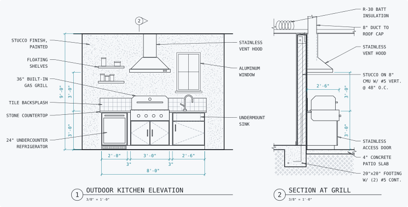

<picture>
  <source media="(prefers-color-scheme: dark)" srcset="https://raw.githubusercontent.com/Surfside-Software/tsdraft/main/docs/assets/tsdraft-logo-dark.svg">
  
</picture>

Write 2D CAD drawings in TypeScript and export them as DXF for CAD programs, or
as SVG for a quick preview.

Working as an agent? Read [the guide for agents](GUIDE.md) first.

[](https://www.npmjs.com/package/tsdraft)
[](https://github.com/Surfside-Software/tsdraft/actions/workflows/ci.yml)
[](LICENSE)

<a href="https://github.com/Surfside-Software/tsdraft/tree/main/examples">
  <picture>
    <source media="(prefers-color-scheme: dark)" srcset="https://raw.githubusercontent.com/Surfside-Software/tsdraft/main/docs/assets/outdoor-kitchen-dark.svg">
    
  </picture>
</a>

The picture is what `toSVG` writes for
[`examples/outdoor-kitchen.ts`](examples/outdoor-kitchen.ts), restyled for this
page with a color for each layer. Its dimensions, leaders and stipple
are small functions in the example that draw lines and text, and every size
comes from a few parameters at the top of the file.
[`examples`](examples) has both drawings and how to run them.

A smaller drawing, start to finish:

```ts
import { createDrawing, DASHED, PHANTOM, toDXF, toSVG } from "tsdraft";

const lot = { width: 120, depth: 80 }; // ft
const setbacks = { front: 20, side: 10, rear: 15 };
const house = { width: 56, depth: 32 };
const x = (lot.width - house.width) / 2;
const y = setbacks.front + 5;

// Linetype patterns are in drawing units. At a scale of 4, DASHED draws dashes of 2 ft and
// PHANTOM long dashes of 5 ft.
const d = createDrawing({ units: "ft", linetypeScale: 4 });

d.layer("C-PROP", { color: 3, linetype: PHANTOM, lineweight: 0.5 }, () => {
  d.rect([0, 0], lot.width, lot.depth);
  d.text([2, -6], `LOT ${lot.width}' x ${lot.depth}'`, { height: 3 });
});
d.layer("C-SETB", { color: 4, linetype: DASHED, lineweight: 0.25 }, () => {
  const { front, side, rear } = setbacks;
  d.rect([side, front], lot.width - side * 2, lot.depth - front - rear);
});
d.layer("A-BLDG", { color: 1, lineweight: 0.7 }, () => {
  d.rect([x, y], house.width, house.depth);
  d.text([x + 2, y + house.depth / 2], "PROPOSED RESIDENCE", { height: 3, lineweight: 0.35 });
});
d.layer("C-PAVE", { color: 8, lineweight: 0.25 }, () => {
  d.line([x + 40, y], [x + 40, -12]);
  d.line([x + 52, y], [x + 52, -12]);
});
d.layer("C-ROAD", { color: 2, lineweight: 0.35 }, () => {
  d.line([-10, -12], [lot.width + 10, -12]);
  d.text([lot.width / 2 - 10, -18], "MAIN STREET", { height: 3 });
});
d.layer("V-TREE", { color: 3, lineweight: 0.18 }, () => {
  for (let i = 0; i < 6; i++) d.circle([15 + i * 18, 72], 5);
});

const drawing = d.build();
const dxf = toDXF(drawing);
const svg = toSVG(drawing);
```

A drawing is a program, so dimensions can come from variables, drawings can
share code, and changes show up as diffs.

Coordinates are in drawing units with Y pointing up, as in CAD. Angles are in
degrees, counterclockwise from +X. Layer colors are AutoCAD Color Index numbers.

`toSVG` draws the drawing as it plots, an insert as what its block draws where the insert
puts it. Each layer is drawn in the color AutoCAD plots its
index in, from 1 to 255. Index 7 is black on paper and white on a dark screen, so it is drawn
in `currentColor`. A layer that is off or frozen, or whose `plot` is false, is left out.
`toSVG(drawing, { drawNoPlot: true })` draws the layers that do not plot too, to see
construction lines. The other options are `margin`, in drawing units, and `strokeWidth`, the
width in screen pixels of a line of the default lineweight.
Entities go on layer `0` unless they are drawn inside a `layer()` callback.
Linetypes and lineweights are set on a layer, and an entity draws ByLayer unless
it is given its own. `DASHED`, `HIDDEN`, `CENTER`, `PHANTOM`, `DASHDOT` and `DOT`
are AutoCAD's own definitions; `d.linetype({ name, pattern })` defines another,
with dashes as positive lengths, gaps as negative ones and dots as 0. A
lineweight is in millimetres.

A text is in the style `Standard` unless it names another. `d.textStyle({ name,
font })` defines one, with a font from `FONTS`: SHX fonts AutoCAD installs and
TrueType fonts Windows installs. `align` and `valign` justify a text to its
point:

```ts
d.textStyle({ name: "NOTES", font: "Arial" });
d.text([60, 40], "PROPOSED RESIDENCE", { height: 3, style: "NOTES", align: "center" });
```

A symbol that repeats is a block: drawn once, and placed by inserts that scale and turn it.
A block's attributes are texts that each insert sets a value for, and that a drafter can edit
in CAD:

```ts
d.block("TREE", {}, () => {
  d.circle([0, 0], 1);
  d.attribute("TAG", [0, 1.2], { value: "T-0", height: 0.3, align: "center" });
});
d.layer("V-TREE", {}, () => {
  d.insert("TREE", [15, 72], { scale: 5, attributes: { TAG: "T-1" } });
  d.insert("TREE", [33, 72], { scale: [6, 5], rotation: 30 });
});
```

An entity on layer `0` of a block draws as the layer of each insert does.
[Blocks](docs/blocks.md) has the rest.

A drawing can reference another drawing's DWG file as an xref, and place it as it places a
block. AutoCAD loads the file each time it opens the drawing:

```ts
d.xref("BASE", "../civil/base.dwg");
d.layer("X-BASE", { color: 8 }, () => d.insert("BASE", [0, 0]));
```

The path leads from the folder of the drawing's file. `toSVG` draws the referenced drawing
when it is given one, as `toSVG(drawing, { xrefs: { BASE: base } })`. [Xrefs](docs/xrefs.md)
has the rest.

Text, symbols and dashes are sized by how large they plot. `fromPaper` turns a
length on paper into drawing units for one scale, given as a plain ratio:

```ts
import { fromPaper } from "tsdraft";

const view = { ratio: 120, units: "ft" } as const; // 1" = 10'
const note = fromPaper(3 / 32, "in", view); // 0.9375 ft
d.text([0, 0], "PROPERTY LINE", { height: note });
```

A paper unit other than `"in"` or `"mm"`, and a length or a ratio of 0 or less,
are compile errors as literals and thrown errors otherwise. `fromPaper` also
throws when the result would be written as 0 or is 1e100 or more.
[`examples/site-plan.ts`](examples/site-plan.ts) is a whole sheet sized this
way, and the file to copy to start a drawing.

## Status

tsdraft is at an early stage. It draws layers, lines, polylines, rectangles,
circles, arcs and single-line text, with linetypes and lineweights, text styles
and justification, blocks with attributes and inserts of them, references to DWG files as
xrefs, and layers that are off, frozen, locked or not plotted. It does not yet have
dimensions, hatches or paper space layouts. It writes DXF, not DWG. The drawing at
the top builds its dimensions, leaders and stipple from lines and text, so in
CAD they are plain lines and text, not dimension or hatch objects.

The rules tsdraft checks are AutoCAD's. Other CAD programs may hold a drawing to
other rules.

## Install

```sh
npm install tsdraft
```

tsdraft is an ES module and needs Node 22 or later. The library imports nothing at run
time, from npm or from Node.

## The `tsdraft` command

The package comes with a command that runs a drawing file and shows the drawing, with no CAD
program:

```sh
npx tsdraft render plan.ts   # writes an SVG and a PNG, and prints JSON with what lint found
npx tsdraft dev plan.ts      # a live preview that redraws on every save
```

A drawing file is a TypeScript module whose default export is a drawing. The command needs
Node 22.18 or later, and the project's `package.json` must say `"type": "module"`.
[docs/command.md](docs/command.md) describes the commands and the JSON, and
[the guide for agents](GUIDE.md) describes the loop to work in.

The PNG is drawn by `@resvg/resvg-js`, the package's one dependency. npm installs it, with a
native build for the platform, unless optional packages are left out. Only the command loads
it. Installed with `--omit=optional`, the command still writes the SVG and the JSON, and the
JSON says why there is no PNG.

## DXF versions

A drawing is written for one DXF version. `createDrawing()` targets R2018, the
version AutoCAD has used since 2018, which is the newest one Autodesk has
published. `createDrawing({ dxf: "R12" })` targets R12, the oldest version still
in common use, which nearly every CAD program can open. `toDXF(drawing)` writes
the drawing's version, and `toDXF(drawing, { version })` writes another one.

|                           | `"R2018"`, the default                                                  | `"R12"`                                            |
| ------------------------- | ----------------------------------------------------------------------- | -------------------------------------------------- |
| Format code               | AC1032                                                                  | AC1009                                             |
| Drawing units             | Stored in `$INSUNITS`.                                                  | Not stored. Set them in CAD with `UNITS`.          |
| Polylines                 | `LWPOLYLINE`                                                            | `POLYLINE` with `VERTEX` records                   |
| Text                      | UTF-8                                                                   | ASCII, with `\U+XXXX` escapes for other characters |
| Layer names               | Up to 255 characters, except those in [the rules](docs/rules.md#errors) | Up to 31 letters, digits, `$`, `-` and `_`         |
| Linetypes, lineweights    | Yes                                                                     | No: only `Continuous`, and no lineweights          |
| Layer off, frozen, locked | Yes, and not plotted                                                    | No                                                 |

R12 gets no new features. Choose it only for a program that cannot read R2018.
CAD needs the stored units to scale a drawing inserted into another, and AutoCAD
shows layer names from an R12 file in upper case.

## Checks

AutoCAD discards a whole drawing over one bad layer name, and it reports no
line of your code when it does. tsdraft checks the rules AutoCAD enforces at
three points, so the mistake shows up where you made it.

1. **In the editor.** Layer names, colors, sizes and fonts written as literals are
   checked by the TypeScript compiler, and the error message says what is wrong.
2. **When the code runs.** The builder throws at the call that breaks a rule.
   This covers values the compiler cannot see, such as a name read from a file.
3. **Before export.** `lint(drawing)` returns every problem in a drawing, and
   `toDXF` throws a `DrawingError` that lists them instead of writing a file
   AutoCAD would reject.

```ts
const d = createDrawing({ units: "ft", dxf: "R12" });

d.layer("A WALL");
// error TS2345: Argument of type '"A WALL"' is not assignable to parameter of
// type '"R12 layer names can only use letters, digits, $, - and _. Use DXF
// version \"R2018\" for other characters"'.

createDrawing().layer("A WALL"); // fine

lint(drawing, { version: "R12" }); // check a drawing against another version
```

## Reference

- [Rules](docs/rules.md) lists what `lint` refuses and what it warns about.
- [The Drawing format](docs/format.md) covers format 0, entity ids, `toJSON`
  and `fromJSON`, and what a diagnostic carries.
- [Layer names](docs/layer-names.md) explains how AutoCAD compares layer and
  linetype names, and lists the pairs `AUDIT` calls duplicates and the
  characters it refuses.
- [Blocks](docs/blocks.md) covers blocks, inserts and attributes: layers in a
  block, names, handles and what the preview draws.
- [Xrefs](docs/xrefs.md) covers references to DWG files: the path, units, a
  missing file, and how the preview draws a referenced drawing.
- [Text](docs/text.md) covers text styles, fonts and justification, what
  tsdraft escapes in text, and what AutoCAD does with it after a save.
- [The `tsdraft` command](docs/command.md) covers `render`, `dev`, the JSON they
  give, and what happens without the PNG renderer.

## Development

Contributors need Node 24 or later and pnpm. Node runs the TypeScript source
directly, so tests and examples need no build step.

```sh
pnpm install
pnpm verify          # format check, lint, type check, tests, package smoke test
pnpm example         # writes both examples to examples/out/ as DXF and SVG
pnpm readme:drawing  # redraws the pictures in docs/assets/ from the examples
pnpm bench           # times the command from a save to the redrawn picture
```

[docs/development.md](docs/development.md) covers the package smoke test, the
TypeScript compilers and releasing.

## Contributing

tsdraft is developed in a private repository and published here through pull
requests from the `export` branch. Issues are welcome.
[`CONTRIBUTING.md`](CONTRIBUTING.md) says how changes arrive.

## License

[MIT](LICENSE)
