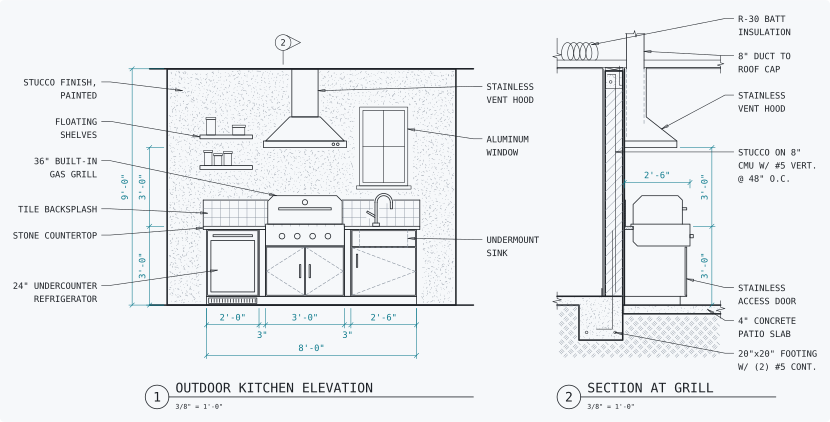
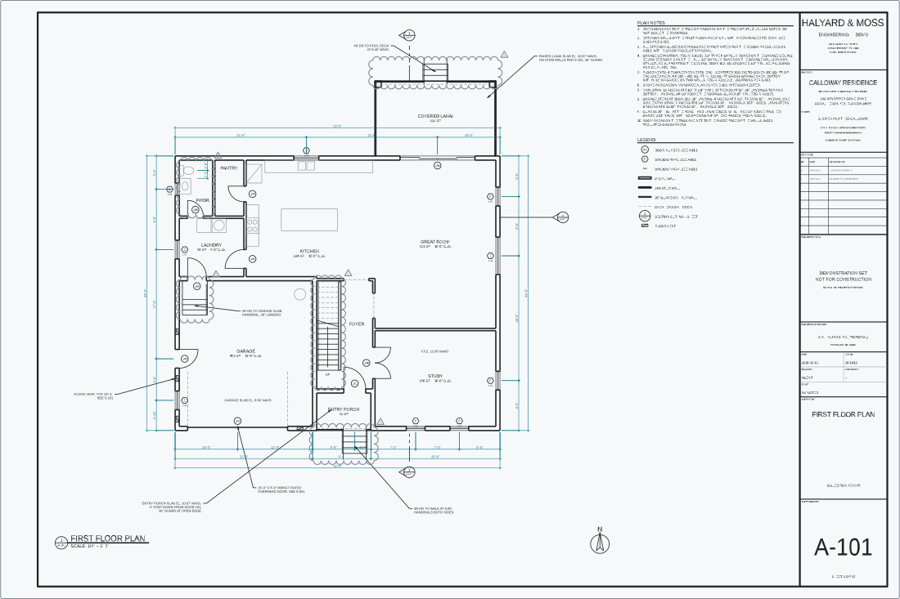
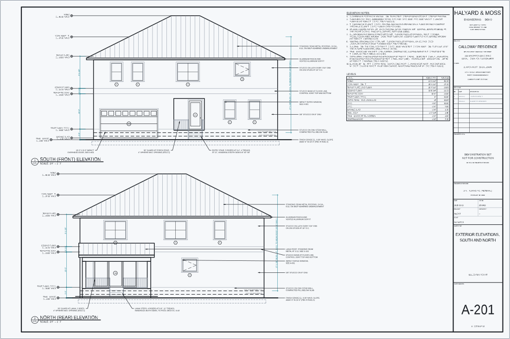

# Examples

Each example builds a drawing and writes it to `examples/out/` as an AutoCAD
2018 DXF and an SVG. `pnpm example` runs them all. The pictures here are the
SVGs restyled by `pnpm readme:drawing`, which gives each layer a color and keeps
the lineweights the drawing sets.

## Outdoor kitchen

<picture>
  <source media="(prefers-color-scheme: dark)" srcset="../docs/assets/outdoor-kitchen-dark.svg">
  
</picture>

An elevation of an outdoor kitchen wall and a wall section through its grill,
at 3/8" = 1'-0". The section runs from the footing and its reinforcing, through
the masonry wall and the cabinet, to the hood's duct, the ceilings and the
insulation above them. The wall, the counter and the run of cabinets are
parameters at the top of [`outdoor-kitchen.ts`](outdoor-kitchen.ts), and every
position, dimension and size in a note is worked out from them. Change the
grill from 36 to 42 inches and the cabinets move, the dimensions change and the
note says 42".

```sh
node examples/outdoor-kitchen.ts
```

The dimensions, leaders, stucco stipple, hatching, earth, insulation, dashed
lines, break lines and view titles come from [`lib/drafting.ts`](lib/drafting.ts).
Each function takes the drawing builder and draws lines, polylines, circles,
arcs and text, so a CAD program opens the result as plain geometry.

## Site plan

<picture>
  <source media="(prefers-color-scheme: dark)" srcset="../docs/assets/site-plan-dark.svg">
  
</picture>

The example sheet: a permit-style site plan on an ARCH D sheet, 36 by 24 inches,
at 1" = 10'. It is the file to copy to start a drawing.

[`site-plan.ts`](site-plan.ts) keeps two spaces, as a drafter does:

- **Model space** holds the site at its true size, in feet: the lot from its
  plat dimensions, the setbacks, the building footprint, the driveway, the
  street and the trees. The annotation that is read in the plan is there too:
  bearings and distances, dimensions and labels. Each names the view `plan`,
  which sizes it by how large it plots at the view's scale. The dimensions
  are dimension objects in the standard's dimension style at that scale, so
  CAD measures them.
- **The layout `C-101`** holds the sheet, in inches of paper: the border, the
  title block, a column of site data, general notes, a legend and
  abbreviations, and under the plan the north arrow, the view's title and a
  graphic scale. A text there has the height it plots at.

One viewport shows the view on the layout at its scale. It is on a layer that
does not plot, so its border stays off the page. AutoCAD opens the file on the
sheet and plots it at 1" = 10' on a page 36 by 24 inches.

Where a thing could go either way, the example puts it with what it belongs
to. The north arrow and the graphic scale describe a view, not the site, so
they are on the sheet beside the view's title, and the scale is numbered from
the viewport's ratio. The legend is part of the sheet. Its lines are drawn on
the plan's own layers, and its dashes are as long as the plan's, because
AutoCAD sizes dashes on the paper in a viewport and on the sheet alike. The
street and the adjoining lot lines are part of the site: they run to the sides
of what the viewport shows, where it cuts them off.

The layout is on the standard's sheet format `arch-d`, which gives its paper,
its title block and the zones it is laid out by, in inches: the border half an
inch inside the paper, the zone `views` for the viewport in the left 27 inches
of the drawing area above the zone `viewTitles` for the view's title, and the
zone `notes`, a column 7 inches wide, above the title block, 6 1/2 by 3 inches
in the lower right corner. The paper is full bleed, and the border is still
inside it: AutoCAD plots a line on the left, bottom or right edge of the paper
with half its width off the page, and does not plot a line on the top edge.

The border and the title block are the standard's, one block, `TITLE BLOCK`,
which `sheet.titleBlock()` places. Its fields are attributes: the project, the
sheet's title and number, the date, the scale, and who drew and checked it. It
also has a table for revisions and an area for a seal. The title comes from the
call, the project, the date and who drew and checked it from `createDrawing`'s
`fields`, the number from the layout's name and the scale from the viewport,
and in CAD each stays an attribute. The view title's attributes have tags of
their own, `VIEW_TITLE` and `VIEW_SCALE`, so no tag names two fields.
[Title blocks](../docs/title-blocks.md) has more, and the way to use a firm's
own border.

The trees, the property corners, the north arrow and the view title are blocks
too. The tree and the property corner are in the plan and in the legend, so
each is inserted in model space and on the layout: the tree at each tree's
radius in the plan and at 3/16 inch in the legend.

The sheet is drawn to a standard of its own, `standard`, which extends
`BUILT_IN_STANDARD` with the layer `V-TREE`. Each layer is named, and its color,
linetype, pen and plot flag are the standard's. The standard's linetype scale
is a length of paper, 1/2. Each text names a role of the standard, which gives
its text style and the height it plots at; the title block's texts are in a
text style of its own, `TITLE BLOCK`. The
view `plan` is at a scale of the standard, `1in-10ft`. Draw it at `1in-20ft`
and nothing on the sheet moves: the plan is half as large in its viewport, and
its text keeps its plotted height. The sheet holds the plan at 1" = 10' and at
1" = 20'. At a larger scale the plan is taller than its viewport.

The picture is the layout, as `toSVG(drawing, { layout: "C-101" })` draws the
sheet, in the page's colors. `sitePlan(scale)` builds the sheet at a scale of
the standard and returns the drawing with where its parts lie: `drawingArea`,
`titleBlock`, the box of each of its `fields` and the `viewport` on the paper,
in inches, and `view`, the part of model space the viewport shows. A test
builds it at `1in-10ft` and at `1in-20ft`. It holds model space inside the
view, the sheet inside the border,
everything but the title block out of the title block's space and off the
viewport, the texts of each space off one another, and each field inside its
box.

The file's default export is the drawing, and it writes its DXF, the SVG of
model space and the SVG of the sheet only when it is run:

```sh
node examples/site-plan.ts
```

It also exports `intent`: the residence keeps out of the setbacks, 25 feet at
the front, 20 at the rear and 7 1/2 at each side, measured from the lot's
sides in the order `rect` draws them. The lot and the residence have the ids
`lot` and `residence`, by which the intent names them. `tsdraft render` and
`tsdraft dev` check it on each build, and a run of the file prints the result.
Move the residence toward the street and the command warns that it is in the
front setback, with the distance it keeps. [Checks of intent](../docs/intent.md)
has more.

## Permit set

<picture>
  <source media="(prefers-color-scheme: dark)" srcset="../docs/assets/plan-set-A-101-dark.svg">
  
</picture>

<picture>
  <source media="(prefers-color-scheme: dark)" srcset="../docs/assets/plan-set-A-201-dark.svg">
  
</picture>

[`plan-set/`](plan-set) is a permit set for a two-story house on a canal lot in
Florida, in 15 sheets on ARCH D: a cover with the sheet index and the code data,
the site plan, the floor plans and the roof plan, the elevations, a building
section with a wall section, the door and window schedules, the foundation plan,
the framing plans and the structural details, and the mechanical, electrical and
plumbing sheets. It is one drawing in inches, with a layout for each sheet.

The project, the owner, the address, the engineer and the firm are made up. The
set shows how a whole set is drawn with tsdraft. It is not a design to build
from: no engineer designed it, and its seal reads "DEMONSTRATION SET, NOT FOR
CONSTRUCTION".

```sh
node examples/plan-set/set.ts
```

It writes the set to `examples/out/plan-set/plan-set.dxf`, the border to
`Set up/TB-ARCHD.dxf` beside it and an SVG of each sheet with its border.
The file's default export is the drawing, so `tsdraft render` and `tsdraft dev`
take it too. It also exports the border's
drawing as `xrefs`, which the pictures draw on each sheet, and `intent`, the
zoning setbacks, which `tsdraft render` and `tsdraft dev` check on each build.

How it is put together:

- [`model/house.ts`](plan-set/model/house.ts) is the house, once: its walls,
  openings, rooms, plate heights, floor depth and roof, in inches from the
  southwest corner of the main block. Every sheet reads it. The floor plans, the
  foundation and framing plans and the mechanical and electrical plans draw the
  same walls, and the elevations, the section and the plumbing risers take their
  heights from it.
- The schedules and tables are worked out in code. The door and window schedules
  list the openings of the model, with each window's design pressure. The cover
  adds up the areas of the house. The panel schedule and the service load count
  the devices the power plan places. The plumbing fixture schedule adds up the
  fixture units of its fixtures. [`project.ts`](plan-set/project.ts) holds the
  project, the firm and the design criteria that the cover, the notes and the
  title block read.
- [`lib/kit.ts`](plan-set/lib/kit.ts) defines the layers, the text styles, the
  symbols as blocks and the helpers the sheets share, and
  [`lib/plan.ts`](plan-set/lib/plan.ts) draws a floor plan of a level at any
  origin. Each sheet draws its views in model space at an origin of its own, so
  no viewport shows another sheet's views, and sizes their annotation for the
  view's scale with `fromPaper`.
- The border is a drawing of its own, `borderDrawing()` in
  [`lib/titleblock.ts`](plan-set/lib/titleblock.ts). Each layout places it as the
  xref `TB-ARCHD`, from the path `Set up/TB-ARCHD.dwg`, the way a firm keeps its
  border in a file of its own. The sheet's fields, such as its title, number,
  date and scale, are the attributes of a block, `SHEET FIELDS`, inserted over
  the border. To load the border in CAD, save its DXF as that DWG, in a
  `Set up` folder beside the set's file.

What the set does not do yet, because tsdraft cannot:

- Hatches and fills are loose lines: earth, insulation and stipple from
  [`lib/drafting.ts`](lib/drafting.ts), and concrete, batt insulation and fill
  from [`sheets/elevations-lib.ts`](plan-set/sheets/elevations-lib.ts).
- Leaders are a polyline, an arrowhead and text, not leader objects.
- A dimension writes only a decimal number, so the example writes the feet and
  inches of each architectural dimension as its text.
- A note is single-line texts, one for each line, broken with `measureText`.
- The title block's fields are attributes the code sets, not fields that CAD
  fills from the file and the layout.

The set is also drawn without a standard. Its layers, text styles and text
heights are its own, in `lib/kit.ts`, and its border is an xref and a block of
its own rather than a standard's title block. To draw a sheet of your own, start
from the [site plan](#site-plan), which takes its sheet format, title block,
layers and text roles from a standard.
