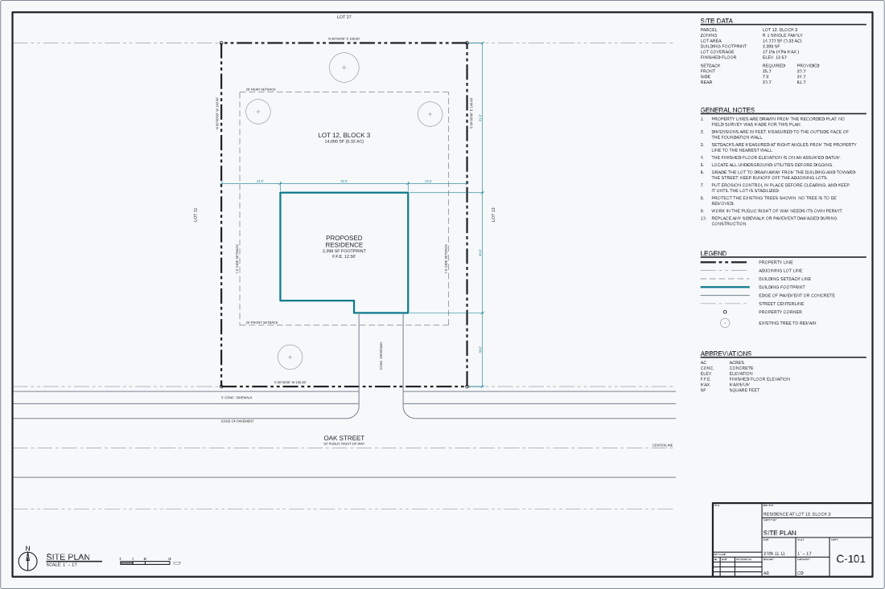

# Examples

Each example builds a drawing and writes it to `examples/out/` as an AutoCAD
2018 DXF and an SVG. `pnpm example` runs both. The pictures here are the SVGs
restyled by `pnpm readme:drawing`, which gives each layer a color and keeps the
lineweights the drawing sets.

## Outdoor kitchen

<picture>
  <source media="(prefers-color-scheme: dark)" srcset="../docs/assets/outdoor-kitchen-dark.svg">
  
</picture>

An elevation of an outdoor kitchen wall and a wall section through its grill,
at 3/8" = 1'-0". The section runs from the footing and its reinforcing, through
the masonry wall and the cabinet, to the hood's duct, the ceilings and the
insulation above them. The wall, the counter and the run of cabinets are
parameters at the top of [`outdoor-kitchen.ts`](outdoor-kitchen.ts), and every
position, dimension and size in a note is worked out from them. Change the
grill from 36 to 42 inches and the cabinets move, the dimensions change and the
note says 42".

```sh
node examples/outdoor-kitchen.ts
```

The dimensions, leaders, stucco stipple, hatching, earth, insulation, dashed
lines, break lines and view titles come from [`lib/drafting.ts`](lib/drafting.ts).
Each function takes the drawing builder and draws lines, polylines, circles,
arcs and text, so a CAD program opens the result as plain geometry.

## Site plan

<picture>
  <source media="(prefers-color-scheme: dark)" srcset="../docs/assets/site-plan-dark.svg">
  
</picture>

The example sheet: a permit-style site plan on an ARCH D sheet, 24 by 36 inches
and landscape, at 1" = 10'. It is the file to copy to start a drawing.

The sheet is a parameter at the top of [`site-plan.ts`](site-plan.ts), 36 wide
by 24 tall in inches on paper, with a 1/2 inch margin. The file works out the
sheet's rectangle and its drawing area in drawing units, and places every block
from them:

- The plan is centered in the left 27 inches of the drawing area: the lot from
  its plat dimensions, with the setbacks, the building footprint, the driveway
  and the street, then the labels and dimension strings. The street and the
  adjoining lot lines run to the sides of that part.
- The north arrow, the view title and the graphic scale are under the plan, at
  the lower left of the drawing area.
- A column 7 inches wide at the right holds the site data, the general notes,
  the legend and the abbreviations, from the top down.
- The lower right corner of the drawing area, 6 1/2 inches wide and 3 inches
  tall, is kept clear. The title block will go there, at the foot of the
  column.

Each layer sets a linetype and a pen weight. The site is in feet, and the
sheet, every text height, annotation offset and column, and the linetype scale,
come from `fromPaper`, as a size on paper at the one ratio the file names.
Change the ratio from 120 to 240 and the notes keep their plotted size and
their place on the sheet, around a plan half as large. The sheet holds the plan
at 1" = 10' and at 1" = 20'. At a larger scale, such as 1" = 8', the plan is
taller than the sheet.

There is no border or title block yet, because tsdraft has no paper space, and
the drawing does not hold the sheet's edge. The picture is framed on the sheet
and outlines its edge, so it shows the drawing as it sits on the paper.
`sitePlan(ratio)` builds the sheet at a ratio and returns the drawing with its
three rectangles in drawing units: `sheetEdge`, `drawingArea` and
`titleBlockSpace`. A test builds it at 120 and at 240, and holds the drawing
inside the drawing area, out of the title block's space, and its texts off one
another.

The file's default export is the drawing, and it writes its DXF and SVG only
when it is run:

```sh
node examples/site-plan.ts
```
